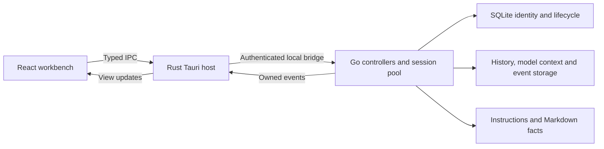

<p align="center">
  
</p>

# Reasonix Tauri

[简体中文](./README.zh-CN.md) · [Desktop build guide](./desktop/tauri/README.md) · [Cua edition](./desktop/cua-runtime/README.md)

A desktop coding agent built around the Reasonix Go engine, a Tauri 2 / Rust host, and a React workbench. Run conversations in parallel, steer ongoing work, branch from a chosen answer, inspect project files, and use voice, browser and application-control tools in the same workspace.

Independently maintained by [woaidachengzi](https://github.com/woaidachengzi), based on [upstream Reasonix](https://github.com/esengine/DeepSeek-Reasonix).

Repository: [woaidachengzi/DeepSeek-Reasonix](https://github.com/woaidachengzi/DeepSeek-Reasonix) · Development branch: `experiment/tauri`

## Current status

Updated **2026-10-26**. Versions belong to separate build configurations, not one universal release number.

| Build | Configuration version | Profile and scope |
| --- | --- | --- |
| Isolated Tauri Preview | `0.1.0` | Separate managed profile for development and migration evaluation |
| macOS original-profile edition | `0.1.58` | Prepared original `~/.reasonix` profile; native macOS computer-control engine |
| macOS Cua edition | `0.1.61` | Same takeover application identity and prepared profile; bundles the Cua Rust runtime; macOS 14+ |
| GNU/Linux Cua Preview | `0.1.62` | Preview identity; ARM64 Ubuntu package and scoped acceptance recorded below |

Sources: [Preview](./desktop/tauri/tauri.conf.json), [takeover](./desktop/tauri/tauri.takeover.conf.json), [macOS Cua](./desktop/tauri/tauri.cua.conf.json), [Linux Cua](./desktop/tauri/tauri.cua.linux.conf.json). Check **Runtime status → Build and version details** for the app actually running. Source support alone does not switch an ordinary installation to Cua.

## What you can do

- **Work across conversations:** navigate while tasks keep running. Output, approvals, cancellation, models, drafts and retained resources belong to their own sessions. Up to 16 resident runtimes, with active work protected from idle eviction.
- **Guide and continue:** submit/cancel steering text during a task, with its content and status shown in the conversation. Continue an existing idle session from an empty composer without adding a visible “continue” message. Enter sends by default; Shift+Enter inserts a newline, with configurable shortcuts.
- **Branch from an answer:** fork at a completed assistant message and continue independently, inheriting pinned context-file selections while retaining the original conversation.
- **Manage projects and files:** rename projects, remove empty sidebar projects without deleting folders, pin context files, add selected text to chat, preview files/diffs, and resize a side-by-side workspace on wide windows.
- **Choose models and inspect usage:** manage providers, credentials and per-session models. Selectors use service display names rather than generated internal IDs. Context, throughput and usage indicators are configurable; subscription/plan usage is distinguished from metered cost estimates.
- **Use voice:** speech-to-text, hold-to-talk, continuous conversations, answer/selection playback and a local cloned-voice library. Recognition is configured independently of the chat model.
- **Connect tools and services:** MCP presets, skills, subagent profiles, hooks, permissions, sandbox, network, memory and diagnostics. Bot desktop-session control, approval handling and event observation are integrated; availability depends on the running gateway, channel access and session ownership.
- **Use remote workspaces:** SSH authentication/fingerprint confirmation, SFTP browsing/editing, remote Serve controls and conversation/controller entry points. SSH connectivity alone does not establish a working remote Agent; model credentials must be configured remotely. Tauri's local-credential proxy mode remains unavailable.

Details: [parallel sessions](./docs/tauri/PARALLEL_SESSIONS.md), [steering](./docs/tauri/SESSION_STEERING.md), [continuation](./docs/tauri/EMPTY_COMPOSER_CONTINUE.md), [dated migration/acceptance log](./docs/tauri/E_MIGRATION_CHECKLIST.md).

## Browser and computer control

| Path | Intended use | Setup |
| --- | --- | --- |
| **Isolated Playwright MCP** | Web tasks in a separate browser context | Settings → MCP & tools → Browser use; Node 24+ and Google Chrome |
| **Cua browser control** | DOM interaction with an approved Chromium window/tab | Cua edition, app access and separate browser-profile/setup consent |
| **Native application control** | Inspect an approved application's accessibility tree/window image, then click, type or use keys | Settings → Computer control; system permissions and compatible workspace policy |

### Application control and Cua

Open **Settings → Computer control** to check the installed engine, system permissions and workspace restrictions. On macOS, grant Accessibility and Screen Recording through System Settings when requested. App access is scoped to the actual process and task; browser-profile access requires an additional explicit decision.

Try: “Inspect the form in this application, fill the draft fields, and verify the result.” The agent observes before acting and should inspect the resulting application state before claiming success. A delivered click does not establish that a submission succeeded.

The Cua edition uses the open-source **Cua Driver Rust SDK 0.38.0** at a pinned revision. Each running task owns a private worker that is cleaned up when the task stops. Browser actions include observation, typing, clicking, navigation, native select options, hover, right-click, double-click, scrolling and dragging. DOM refs belong to the approved window/tab and must be refreshed after navigation.

Screenshots appear in a draggable picture-in-picture preview with a stop control. The native macOS engine also shows a blue-whale indicator for verified physical cursor positions; background AX/CDP actions do not invent cursor movement. This adapter exposes neither arbitrary browser JavaScript nor a generic shell/full-desktop capture API.

See the [Cua runtime guide and build instructions](./desktop/cua-runtime/README.md), [cursor behavior](./docs/tauri/COMPUTER_USE_CURSOR.md), and [AI diagnostic export](./docs/tauri/AI_DIAGNOSTIC_LOGS.zh-CN.md).

### Isolated Playwright MCP

Review and save the preset in **Settings → MCP & tools → Browser use**. It pins the official [Microsoft Playwright MCP](https://github.com/microsoft/playwright-mcp) to `0.0.83`, enables screenshot/vision tools and disables page-provided WebMCP tools. Start a new session, or apply the setting to an idle session, then try:

```text
/browser-use Open https://example.com, inspect the page, and take a screenshot.
```

Each Tauri session owns its MCP process and isolated browser context. This path does not inherit ordinary browser logins; its login state is discarded when the session closes. DOM/accessibility operations can work with tool-capable text models; interpreting screenshots requires a vision-capable model or configured image fallback.

## Voice

Configure **Settings → Speech recognition** separately from the chat provider. MiMo ASR and the supported custom-service formats have a recording test; saving an endpoint does not establish availability. Voice controls retain drafts when switching text/voice modes, support playback cancellation, and retry failed speech without replaying successful segments.

Cloned voices use local MP3/WAV samples and a selected voice ID; samples are not included in source control or packages. Recognition audio and samples required for cloud synthesis are sent to the selected service. Provider support, credentials, microphone permission and quota still apply. Implementation and scoped acceptance are in the [migration log](./docs/tauri/E_MIGRATION_CHECKLIST.md).

## Why Tauri

- **Keep the engine:** model calls, tools, configuration and recovery remain in Go, allowing the desktop host to evolve independently.
- **Give native resources one owner:** Rust supervises sidecars, windows, menus, dialogs, credentials and desktop integrations; React uses typed commands/events.
- **Use the system WebView:** WKWebView on macOS, WebView2 on Windows and WebKitGTK on Linux, without shipping a separate browser runtime for the workbench.
- **Separate application and data choices:** Preview and takeover identities allow isolated verification before using an existing profile.

Practical improvements combine host, rendering, history and lifecycle fixes. No controlled Wails-versus-Tauri memory or latency benchmark is claimed.

## History, persistence and memory



| Responsibility | Current design |
| --- | --- |
| Identity | Persistent SQLite directory with IDs, profile-relative locations, title revisions, workspace, order and lifecycle; recent-session lists are navigation metadata |
| Presentation | Audited directory paging/cache, bounded history responses and cold Markdown readiness before revealing a newly opened conversation |
| Model context | Display history and the compacted workset remain separate, with coverage/provenance checks |
| Original-profile compatibility | Registered Wails JSONL paths and supported older projections are preserved; unknown/changed identities are not silently opened as new empty sessions |
| Experimental event authority | Managed Preview can use the SQLite event DAG and rebuild JSONL projections; this gated capability is not a blanket migration of takeover, custom-profile, CLI or Wails data |
| Durable context | Standing instructions are separate from fallible project/global Markdown facts; retrieval is budgeted and scoped, with revisions and provenance |

The bridge currently returns at most the latest **200 visible history messages**. This does not imply complete backward scroll pagination; engine recovery may still read the full transcript. SQLite identity storage must not be confused with a completed migration of every profile's messages into SQLite.

Memory uses Reasonix **Context Engine v2**: hierarchical `REASONIX.md` / `AGENTS.md` / `CLAUDE.md` instructions, project/global facts, explicit pinning, conservative automatic recall, and confirmation/revision checks for writes. It is separate from persistence and does not imply a complete port of MiMo's checkpoint-writer, Dream or Distill.

Details: [session storage](./docs/tauri/SESSION_STORAGE_IMPLEMENTATION_V3.md), [gated SQLite event-store RFC](./docs/tauri/SESSION_SQLITE_EVENT_STORE_RFC.md), [memory/retrieval](./docs/SESSION_MEMORY_RETRIEVAL.md), [takeover](./docs/tauri/STABLE_TAKEOVER.md).

## Platform evidence and limits

| Platform | Recorded scope |
| --- | --- |
| macOS Apple Silicon | Original-profile use and native desktop workflows; installed Cua 0.1.61 used the ordinary chat/tool/approval chain and an account-free Chrome fixture to verify Chinese input, selection, one trusted click and destination DOM after navigation |
| Ubuntu 26.04 ARM64 | Ordinary Preview packaging/manual acceptance; Cua Preview 0.1.62 deb/AppImage built, installed and audited, with GTK control on X11/XWayland, Chromium Snap on an owned Xvfb server, lifecycle and packaged-settings checks |
| Windows x64 | Ordinary Tauri NSIS build/package checks; Cua/native computer control is not integrated, and the full manual matrix remains separate |
| Other Linux environments | Same-architecture build support does not establish x86_64, other-distribution or compositor acceptance |

Linux native Wayland remains experimental/off by default. The pinned helper refuses GNOME 50+ native Wayland windows; Ubuntu 26.04 acceptance uses XWayland-compatible applications. Linux screenshot-coordinate `move` is not exposed; DOM-ref hover is available. Linux fixture results do not establish real model-driven chat or everyday browser-profile acceptance.

macOS results do not establish production-account, canvas-only or every-application coverage. Local macOS packages use ad hoc signing; Apple notarization and an automatic update channel are not established. Cua packages include third-party notices and required source archives; not all transitive dependencies are MIT.

Evidence: [installed macOS Cua](./docs/tauri/evidence/2026-10-25-cua-installed/README.md), [browser actions](./docs/tauri/evidence/2026-10-25-cua-browser-actions/README.md), [Linux Cua](./docs/tauri/evidence/2026-10-26-cua-linux/README.md), [Windows Preview](./docs/tauri/WINDOWS_PREVIEW_ACCEPTANCE.md), [ordinary Linux Preview](./docs/tauri/LINUX_PREVIEW_ACCEPTANCE.md).

## Install and choose a profile

Use a package for your exact platform, architecture and desired engine, and verify its supplied SHA256. On macOS, drag **Reasonix Tauri** from the DMG into Applications. Cua packages contain both the Go bridge and the private Cua runtime; ordinary packages do not. Check Runtime status and Computer control after installing.

- **Preview:** a separate managed profile. Existing-data import is explicit; custom `REASONIX_HOME` remains subject to profile protections.
- **Original-profile takeover:** directly uses the original default `~/.reasonix` after verified backup and offline preparation. A matching `tauri-takeover-v1.json` receipt is required; building/installing does not prepare the profile. Keep the backup and fully quit Wails before opening takeover. Follow the [preparation and rollback guide](./docs/tauri/STABLE_TAKEOVER.md).

For a supplied Linux deb, verify the package manifest, then install that exact file with `sudo apt install ./<package>.deb`. AppImages need executable permission; `APPIMAGE_EXTRACT_AND_RUN=1` is an alternative without FUSE. Linux Cua retains the Preview identity, not the macOS takeover identity.

Packages contain no maintainer API keys, personal configuration or cloned-voice samples. Configure your own providers. Linux system credential storage requires session D-Bus and Secret Service.

## Build

Ordinary builds need **Node 24+**, **pnpm 10.34.5**, Go matching `go.mod` (toolchain **1.26.6**), Rust and native build/WebView dependencies. The ordinary host declares Rust 1.89+; Cua has additional system/SDK prerequisites in its [build guide](./desktop/cua-runtime/README.md).

```bash
git clone --branch experiment/tauri https://github.com/woaidachengzi/DeepSeek-Reasonix.git
cd DeepSeek-Reasonix
pnpm --dir desktop/frontend install --frozen-lockfile
pnpm --dir desktop/frontend tauri:dev
```

macOS packages:

```bash
# Isolated Preview
pnpm --dir desktop/frontend tauri:build
# Original-profile edition: prepare the profile separately before launch
pnpm --dir desktop/frontend tauri:build -- --config tauri.takeover.conf.json --bundles app,dmg
# Cua: macOS 14+, Python 3.12+, pinned SDK and additional prerequisites
python3 desktop/cua-runtime/scripts/build.py --bundle
```

Native Windows and GNU/Linux:

```powershell
# Windows: Visual Studio C++ Build Tools and ordinary Tauri prerequisites
powershell -ExecutionPolicy Bypass -File desktop/tauri/scripts/build-windows.ps1
```

```bash
# Ordinary Linux Preview, on the target architecture
bash desktop/tauri/scripts/build-linux.sh
# Linux Cua, with its X11/PipeWire build dependencies and AT-SPI environment
python3 desktop/cua-runtime/scripts/build.py --bundle --bundles deb
```

The Cua script handles source fetching, revision checks, notices and platform configuration. Linux builds are native/same-architecture; this path does not support macOS-to-Linux cross-packaging. Tauri uses the local frontend CLI without Wails CLI. The inherited Go CLI still builds with `make build`; [legacy Wails instructions](./desktop/README.md) describe a separate desktop host.

## Documentation

- [Tauri host and historical acceptance](./desktop/tauri/README.md)
- [Cua engine, permissions, build and limits](./desktop/cua-runtime/README.md)
- [AI diagnostic export](./docs/tauri/AI_DIAGNOSTIC_LOGS.zh-CN.md)
- [Parallel sessions](./docs/tauri/PARALLEL_SESSIONS.md) · [Steering](./docs/tauri/SESSION_STEERING.md) · [Continuation](./docs/tauri/EMPTY_COMPOSER_CONTINUE.md)
- [Takeover/rollback](./docs/tauri/STABLE_TAKEOVER.md) · [Session storage](./docs/tauri/SESSION_STORAGE_IMPLEMENTATION_V3.md) · [SQLite events](./docs/tauri/SESSION_SQLITE_EVENT_STORE_RFC.md)
- [Instructions, memory and retrieval](./docs/SESSION_MEMORY_RETRIEVAL.md)
- [Dated migration log](./docs/tauri/E_MIGRATION_CHECKLIST.md) · [API audit](./docs/tauri/API_SURFACE_AUDIT.md)
- Inherited engine: [Guide](./docs/GUIDE.md) · [CLI](./docs/CLI.md) · [ACP](./docs/ACP.md) · [Extensions](./docs/EXTENSIONS.md) · [Configuration paths](./docs/CONFIG_PATHS.md)

Historical evidence retains its original date and scope. Older failures/successes do not by themselves describe the current package; engine and Wails documents may describe upstream behavior rather than this adaptation.

## Origin and license

The upstream engine and inherited features come from [esengine/DeepSeek-Reasonix](https://github.com/esengine/DeepSeek-Reasonix). The Tauri host and branch-specific improvements are independently maintained here. The retained logo is credited to [Bernardxu123](https://github.com/Bernardxu123).

Original copyright and MIT notices remain in [LICENSE](./LICENSE). Cua and its dependencies retain separate notices/source obligations as documented in the runtime guide.
