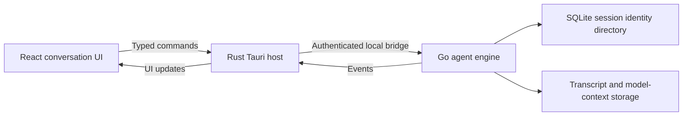

<p align="center">
  
</p>

# Reasonix Tauri

[简体中文](./README.zh-CN.md) · [Tauri host](./desktop/tauri/README.md) · [Migration checklist](./docs/tauri/E_MIGRATION_CHECKLIST.md)

An independently maintained Tauri desktop adaptation of Reasonix. This branch focuses on the desktop experience, configuration management, and native packaging for macOS, Windows, and Linux, while retaining the existing Go agent engine.

Repository: [woaidachengzi/DeepSeek-Reasonix](https://github.com/woaidachengzi/DeepSeek-Reasonix) · Branch: `experiment/tauri`

## Maintenance and project scope

This adaptation is independently developed and maintained by [woaidachengzi](https://github.com/woaidachengzi). The Tauri migration and the improvements described below are work on this fork; the original Go engine and inherited features come from upstream Reasonix.

There are two explicit desktop modes:

| Mode | Version / application identity | Data behavior |
| --- | --- | --- |
| **Reasonix Tauri Preview** | `0.1.0` / `io.reasonix.desktop.preview` | Uses a separate managed profile for development and isolated evaluation |
| **Reasonix Tauri** (original-profile takeover) | `0.1.7` / `io.reasonix.desktop.takeover` | Uses the original `~/.reasonix` after verified backup and offline preparation |

The previous macOS Apple Silicon takeover candidate (0.1.3) passed current-history and restart acceptance, and the maintainer confirmed practical use. Version 0.1.4 adds parallel conversations; its separate acceptance scope is recorded below. This is a verified migration path for the tested profile, not a claim that all historical formats, platforms, or release gates are complete.

## Work on this branch

- **Tauri desktop host:** a Rust shell supervises the Go sidecar, native windows, menus, and desktop services; the frontend uses a typed bridge.
- **Desktop workbench:** projects and sessions, model selection, streamed conversations, Markdown, attachments, and session lifecycle management.
- **History and navigation:** persistent session identities, paged directory reads, cached directory snapshots, bounded history responses, and navigation independent of running sessions. Projects can be renamed; empty projects can be removed from the sidebar without deleting disk files.
- **Steer running tasks (0.1.6):** submit text guidance without stopping the active task. Stop remains separate; rejected guidance keeps its draft, and approvals remain required. Version 0.1.7 adds explicit Submit/Cancel controls and cards showing guidance content and status. See [behavior, latest upstream references and acceptance](./docs/tauri/SESSION_STEERING.md).
- **Empty-composer continuation (0.1.5):** continue a loaded idle conversation using its current model without adding a visible user message. New conversations still require input. See [behavior and regression checks](./docs/tauri/EMPTY_COMPOSER_CONTINUE.md).
- **Parallel conversations:** switch views while tasks continue; independent output, approvals, cancellation, model settings and drafts. Up to 16 resident runtimes, with active tasks and retained resources protected from eviction. See the [architecture and acceptance record](./docs/tauri/PARALLEL_SESSIONS.md).
- **Message-level conversation forks:** fork from a completed assistant answer and continue in an independent conversation; the source remains available.
- **Pinned context files:** select workspace files as persistent conversation context; forks inherit the pinned-file selection.
- **Original-profile takeover:** verified backup, original-path registration for current Wails JSONL histories, and compatible projections for selected older v5 records. Configuration and original source records are preserved during preparation.
- **Model and configuration pages:** provider/model settings, credential save/delete, and consistent model-preference and model-service page backgrounds across themes and layouts.
- **Remote management:** SSH authentication and host-fingerprint confirmation, SFTP browsing/editing/path operations, and Serve status/log/start/stop controls with a system-browser controller entry.
- **Bot and management migration:** account management, pairing approvals, and settings surfaces for permissions, plugins, MCP, hooks, memory, subagents, data, and diagnostics. Migration and real-service acceptance remain incremental.
- **Native packages:** Windows x64 NSIS and native Linux ARM64 deb/AppImage previews, plus platform-specific tray and window-close handling.
- **Profile isolation and verification:** Preview-managed data is separate from the stable profile; source identity, regression tests, package hashes, and acceptance records accompany the migration.

These are implemented areas, not a claim of complete Wails feature parity. Native remote tabs, remaining bot workflows, and package-level management-page acceptance are tracked in the [E migration checklist](./docs/tauri/E_MIGRATION_CHECKLIST.md). Automatic updates are outside the current migration scope.

## Browser use (preview)

In **Settings → MCP & tools → Browser use**, choose **Configure browser use** and save the reviewed preset. It uses the official [Microsoft Playwright MCP](https://github.com/microsoft/playwright-mcp), pinned to `0.0.83`, with Chrome, isolated storage, screenshot/vision tools, and page-provided WebMCP tools disabled. Requires Node.js 24+ and Google Chrome; the first connection downloads the npm package.

Start a new session, or **Apply to current session** while idle. Then try `/browser-use Open https://example.com, inspect the page, and take a screenshot`. The shipped inline skill guides discovery, observation, actions, and verification. Page structure actions work with tool-capable models; screenshot understanding needs a vision-capable model or configured image fallback.

Each Tauri session owns its MCP process and isolated browser context. It does not inherit your normal browser logins; sign in in the new browser window if required. Closing the session discards that login state. This preview operates web pages; native desktop app control is outside this integration's scope.

An opt-in real-tool test covers navigation, typing, clicking, screenshot image return, and isolation between two MCP hosts:

```bash
REASONIX_LIVE_PLAYWRIGHT_MCP=1 go test ./internal/plugin -run '^TestPlaywrightMCPLive$' -v -count=1 -timeout=4m
```

## Why Tauri in this project

- **A native desktop host with the existing web UI.** Tauri uses the operating system's WebView: WKWebView on macOS, WebView2 on Windows, and WebKitGTK on Linux. This avoids distributing a separate browser runtime. See the official [process model](https://v2.tauri.app/concept/process-model/).
- **Clear ownership of desktop operations.** Rust owns windows, menus, dialogs, credential storage, and sidecar supervision. The React UI uses typed commands and events instead of managing these resources directly. Tauri's [IPC model](https://v2.tauri.app/concept/inter-process-communication/) provides this boundary; the project's bridge enforces its own protocol and validation.
- **Reuse of the Go agent engine.** Model calls, tools, configuration, and session recovery stay in Go. We can improve the desktop host without rewriting the established agent behavior; Rust supervises sidecar startup, restart, and cleanup.
- **Separate packaging and profile choices.** Native package configuration and explicit Preview/takeover identities let us validate desktop changes against private fixtures before using an existing profile.

The improvement reported during practical use combines host work with history, rendering, and lifecycle fixes. We have not published a controlled benchmark comparing Wails and Tauri memory use or latency.

## History-session architecture



The recent-session list is now navigation metadata, rather than the only authority for session existence. A persistent identity directory and verified transcript ownership underpin opening, paging, renaming, and deletion.

| Layer | Change | Practical effect |
| --- | --- | --- |
| Identity directory | SQLite stores session ID, profile-relative path, workspace, title/revision, order, and lifecycle state | Identity survives restart; a deleted, missing, or changed-path session cannot silently become a new blank conversation |
| Original-path compatibility | Imported Wails IDs bind to a hash of the original profile-relative JSONL path | Current project histories remain in their original locations; unknown or mismatched legacy IDs are rejected |
| Directory and history reads | Directory cursors include snapshot identity; audited directory snapshots are cached, checks run off the native event loop, and the history response contains at most the latest 200 visible messages | Reduces repeated directory audits and the amount sent to/rendered in the UI; stale directory pages cannot be mixed silently |
| Display and model context | Full display history and the compacted model workset are preserved separately, with coverage/provenance checks | Imported conversations retain readable history and their existing model context rather than rebuilding context from the UI text |
| Forks and pinned files | A completed-answer prefix token identifies the fork position; child sessions receive independent identities and inherit pinned-file selection | Continue from a chosen answer without replacing the original conversation |
| Takeover preparation | Stop writers, verify a complete backup, prepare new identities/compatible projections under a profile gate, then publish a completion receipt | The takeover host refuses an unprepared profile; unsupported old binaries still require operational separation |

The 200-message history response is a current display bound, not complete scroll-back pagination. The engine may still read the full transcript for recovery. End-to-end performance and older-message browsing remain areas for further work.

The current takeover acceptance covered **25 current conversations**: **21** reused original JSONL paths and **4** used matching older v5 projections. Packaged-host checks opened all 25 and verified matching history counts after restart. Actual native UI checks also covered reopening original history, recent-list registration, startup replay, and the fork entry. These counts describe the tested profile, not every user's data. See the [takeover implementation and acceptance record](./docs/tauri/STABLE_TAKEOVER.md).

## Platform status

Status as of 2026-10-14; Windows/Linux rows retain their 2026-10-07 evidence:

| Platform | Package | Current evidence |
| --- | --- | --- |
| macOS Apple Silicon | `0.1.7` takeover app / DMG; isolated Preview also available | Parallel execution verified with actual Go controllers, headless React UI and a packaged Preview supervisor using private fixtures; 0.1.4 passed original-history navigation, draft isolation and private Preview parallel clicks; 0.1.5 adds empty-composer continuation; 0.1.6 adds steering with actual Go controller and browser UI coverage; ad hoc signed, not Apple notarized |
| Windows x64 | NSIS installer `.exe` | Built and package contents checked; the full native manual matrix remains unrecorded |
| Ubuntu 26.04 ARM64 | `.deb` / `.AppImage` | Native build, 224 Rust tests passed / 1 ignored, package audit completed; maintainer confirmed manual acceptance |
| Linux x64 / other distributions | Native build support and manual x64 packaging workflow | Not validated by the Ubuntu ARM64 result |

See [Windows acceptance](./docs/tauri/WINDOWS_PREVIEW_ACCEPTANCE.md), [Linux acceptance](./docs/tauri/LINUX_PREVIEW_ACCEPTANCE.md), and [Ubuntu package hashes](./docs/tauri/evidence/2026-10-07-linux-arm64/README.md).

The `0.1.7` takeover candidate is a local macOS handoff; it does not establish a notarized, automatically updated stable release channel. Upstream npm packages, websites, downloads, and signing statements do not describe this fork's Tauri packages.

## Install and choose a data mode

Use the package handed off for your exact OS and architecture, and verify its supplied SHA256 before running it. Install/launch **Reasonix Tauri Preview**, then configure a provider and model in the application.

For the macOS Apple Silicon takeover package, open `Reasonix Tauri_0.1.7_aarch64.dmg` and drag **Reasonix Tauri** into Applications. The original profile must already have a verified backup and a matching `tauri-takeover-v1.json` completion receipt; building/installing the app does not perform this preparation. Keep the referenced backup available and fully quit Wails before starting the takeover app. Preparation and rollback are described in the [takeover record](./docs/tauri/STABLE_TAKEOVER.md). The local candidate uses ad hoc signing and is not Apple notarized.

For the Ubuntu ARM64 handoff, open a terminal in the package directory:

```bash
sha256sum -c SHA256SUMS
sudo apt install "./Reasonix Tauri Preview_0.1.0_arm64.deb"
```

AppImage alternative:

```bash
chmod +x "./Reasonix Tauri Preview_0.1.0_aarch64.AppImage"
"./Reasonix Tauri Preview_0.1.0_aarch64.AppImage"
# If FUSE is unavailable:
APPIMAGE_EXTRACT_AND_RUN=1 "./Reasonix Tauri Preview_0.1.0_aarch64.AppImage"
```

Packages do not include the maintainer's personal API keys or configuration. Default model entries are not saved credentials; supply your own provider credentials. Linux system credential storage requires an available session D-Bus and Secret Service.

The default managed Preview profile is isolated from the stable `~/.reasonix` profile. Existing data is imported only through an explicit action. In Preview mode, an explicitly supplied `REASONIX_HOME` selects a profile subject to the host's profile protections. The takeover installation selects the original default profile and checks its completion receipt instead. Do not substitute an environment override for verified takeover preparation.

## Build this branch

Prerequisites: Node 24+, pnpm 10.34.5, Go matching `go.mod` (currently toolchain 1.26.6), Rust 1.89+, and your platform's native build/WebView dependencies. The local frontend Tauri CLI is used; Wails CLI is not required for the Tauri build.

```bash
git clone --branch experiment/tauri https://github.com/woaidachengzi/DeepSeek-Reasonix.git
cd DeepSeek-Reasonix
pnpm --dir desktop/frontend install --frozen-lockfile
pnpm --dir desktop/frontend tauri:dev
```

Isolated macOS Preview package:

```bash
pnpm --dir desktop/frontend tauri:build
```

macOS original-profile takeover package (requires separate profile preparation before launch):

```bash
pnpm --dir desktop/frontend tauri:build -- --config tauri.takeover.conf.json --bundles app,dmg
```

The takeover app and DMG are generated under `desktop/tauri/target/release/bundle/`. This candidate's takeover acceptance is macOS Apple Silicon only.

Windows native build, from the repository root after installing Visual Studio C++ Build Tools:

```powershell
powershell -ExecutionPolicy Bypass -File desktop/tauri/scripts/build-windows.ps1
```

Native GNU Linux build, on the same architecture after preparing GTK/WebKitGTK and other required libraries:

```bash
bash desktop/tauri/scripts/build-linux.sh
# Debian package only:
bash desktop/tauri/scripts/build-linux.sh deb
```

Linux packages are generated under `desktop/tauri/target/<native Rust triple>/release/bundle/`. This packaging path does not support macOS-to-Linux or cross-architecture Linux builds. See the [Tauri host guide](./desktop/tauri/README.md) for details and Windows cross-build prerequisites.

The inherited CLI can still be built with `make build`; legacy Wails instructions are in [desktop/README.md](./desktop/README.md). These are separate from the Tauri Preview build.

## Documentation

- [Tauri host, development, and profile boundaries](./desktop/tauri/README.md)
- [MiMo model switching fix in 0.1.3](./docs/tauri/MIMO_MODEL_SWITCH_RECOVERY.md)
- [History model recovery in 0.1.2](./docs/tauri/HISTORY_MODEL_RECOVERY.md)
- [Original-profile takeover, acceptance, and rollback](./docs/tauri/STABLE_TAKEOVER.md)
- [E migration scope and remaining work](./docs/tauri/E_MIGRATION_CHECKLIST.md)
- [API surface audit and release gates](./docs/tauri/API_SURFACE_AUDIT.md)
- [Windows preview acceptance](./docs/tauri/WINDOWS_PREVIEW_ACCEPTANCE.md)
- [Linux preview acceptance](./docs/tauri/LINUX_PREVIEW_ACCEPTANCE.md)
- Inherited engine documentation: [Guide](./docs/GUIDE.md) · [CLI](./docs/CLI.md) · [ACP](./docs/ACP.md) · [Extensions](./docs/EXTENSIONS.md) · [Configuration paths](./docs/CONFIG_PATHS.md)

Engine and legacy desktop documents may describe upstream/Wails behavior; use the Tauri migration and acceptance records for this Preview's actual scope.

## Project origin and license

This fork is based on [esengine/DeepSeek-Reasonix](https://github.com/esengine/DeepSeek-Reasonix). Thanks to the upstream authors and contributors for the original engine and project foundation. The retained project logo is credited to [Bernardxu123](https://github.com/Bernardxu123).

Upstream contributors are historical contributors to that foundation, not a list of developers working on this Tauri adaptation. This README does not display an upstream contribution leaderboard or donation destination as belonging to this fork.

The original copyright and MIT license notice are retained in [LICENSE](./LICENSE).
