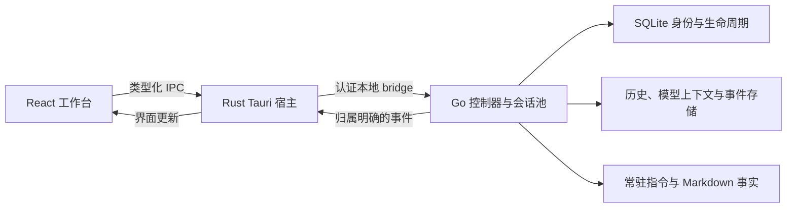

<p align="center">
  
</p>

# Reasonix Tauri

[English](./README.md) · [桌面构建指南](./desktop/tauri/README.md) · [Cua 版说明](./desktop/cua-runtime/README.md)

基于 Reasonix Go 引擎、Tauri 2 / Rust 宿主和 React 工作台的桌面编程 Agent。支持多会话并行、运行中引导、消息级分叉、工作区文件查看，以及语音、浏览器和应用操作。

由 [woaidachengzi](https://github.com/woaidachengzi) 独立开发维护，基于[上游 Reasonix](https://github.com/esengine/DeepSeek-Reasonix)。

当前仓库：[woaidachengzi/DeepSeek-Reasonix](https://github.com/woaidachengzi/DeepSeek-Reasonix) · 开发分支：`experiment/tauri`

## 当前进度

更新于 **2026-10-26**。下列版本属于不同构建配置，不是所有平台共用的一个发布版本号。

| 构建方式 | 配置版本 | 资料模式与范围 |
| --- | --- | --- |
| 隔离 Tauri Preview | `0.1.0` | 独立托管资料目录，用于开发与迁移验证 |
| macOS 原资料接管版 | `0.1.58` | 使用已准备的原 `~/.reasonix`；包含原生 macOS 电脑控制引擎 |
| macOS Cua 版 | `0.1.61` | 沿用接管应用身份和已准备的原资料；额外打包 Cua Rust runtime；需要 macOS 14+ |
| GNU/Linux Cua Preview | `0.1.62` | 使用 Preview 身份；已记录 ARM64 Ubuntu 安装包与限定范围验收 |

版本来源：[Preview](./desktop/tauri/tauri.conf.json)、[接管版](./desktop/tauri/tauri.takeover.conf.json)、[macOS Cua](./desktop/tauri/tauri.cua.conf.json)、[Linux Cua](./desktop/tauri/tauri.cua.linux.conf.json)。实际运行版本请看 **运行状态 → 构建与版本详情**。源码中包含 Cua 集成，不代表已安装的普通包会自动切换引擎。

## 已接入的功能

- **多会话并行**：运行中可切换和提交其他对话；输出、审批、停止、模型、草稿与保留资源分别归属对应会话。运行池最多驻留 16 个实例，活跃任务不会被当作空闲实例淘汰。
- **运行中引导与继续执行**：追加指令调整任务方向，支持提交／取消，并显示引导原文及状态。已有空闲对话可在空输入时继续，不必再发送一条“继续”。默认 Enter 发送、Shift+Enter 换行，也可配置快捷键。
- **消息级分叉**：从已完成的助手回答处分叉，在独立对话中继续，继承固定上下文文件选择，保留原对话。
- **项目与工作区**：项目改名、移除空项目而保留磁盘文件、固定上下文文件、选文引用、文件／差异预览，以及宽窗口中可拖动调宽的并排工作区。
- **模型与用量**：服务、凭据及当前会话模型管理；列表显示服务名称，不再直接展示生成的内部标识。上下文、吞吐和用量指标可配置，套餐／订阅与按量计费估算区别呈现。
- **语音交互**：录音转文字、按住说话、连续语音对话、回答／选文播报、本机克隆音色库；语音识别独立于聊天模型配置。
- **工具与服务**：MCP 预设、技能、子智能体档案、hooks、权限、沙箱、网络、记忆与诊断。机器人已接入桌面会话控制、审批和事件监听，实际可用性取决于网关运行、渠道授权与会话归属。
- **远程工作区**：SSH 认证／指纹确认、SFTP 浏览和编辑、远端 Serve 控制及会话／控制器入口。SSH 连通不等于 Agent 已就绪；模型凭据需要在远端配置，Tauri 暂不支持本地凭据代理模式。

详见[多会话并行](./docs/tauri/PARALLEL_SESSIONS.md)、[运行中引导](./docs/tauri/SESSION_STEERING.md)、[空输入继续](./docs/tauri/EMPTY_COMPOSER_CONTINUE.md)及按日期记录的[迁移／验收日志](./docs/tauri/E_MIGRATION_CHECKLIST.md)。

## 浏览器与电脑控制

| 路径 | 适用场景 | 配置入口 |
| --- | --- | --- |
| **隔离 Playwright MCP** | 在独立浏览器环境中完成网页任务 | 设置 → MCP 与工具 → 浏览器操作；需要 Node 24+ 与 Google Chrome |
| **Cua 浏览器控制** | 通过 DOM 操作已授权的 Chromium 窗口和标签页 | 安装 Cua 版，分别完成应用访问、浏览器资料／准备授权 |
| **原生应用控制** | 查看授权应用的可访问性树、窗口截图，再点击、输入或按键 | 设置 → 电脑控制；系统权限与工作区策略须允许 |

### 应用操作与 Cua 版

进入 **设置 → 电脑控制**，检查实际引擎、系统权限和工作区限制。macOS 需要按提示在系统设置中授予辅助功能与屏幕录制权限。应用访问绑定实际进程和当前任务，浏览器资料访问另行确认。

可以先尝试：“查看这个应用中的表单，填写草稿字段，再检查结果。”Agent 先观察再执行，并应通过操作后的应用状态核对结果；点击已发出，不等于业务提交已经成功。

Cua 版使用固定源码版本的开源 **Cua Driver Rust SDK 0.38.0**。每个运行任务持有独立私有 worker，停止任务时清理。浏览器支持观察、输入、点击、导航、原生下拉框选择、悬停、右键、双击、滚动和拖动；DOM 引用归属具体窗口／标签页，导航后需要重新观察。

截图显示在可拖动、可停止任务的画中画中。原生 macOS 引擎还有蓝色小鲸鱼落点指示器；后台 AX/CDP 操作不会伪造系统鼠标移动。本适配器没有开放任意浏览器 JavaScript、通用 shell 或全桌面截图接口。

详见 [Cua runtime 与构建指南](./desktop/cua-runtime/README.md)、[光标行为](./docs/tauri/COMPUTER_USE_CURSOR.md)和 [AI 诊断导出](./docs/tauri/AI_DIAGNOSTIC_LOGS.zh-CN.md)。

### 隔离 Playwright MCP

在 **设置 → MCP 与工具 → 浏览器操作** 中检查并保存预设。使用官方 [Microsoft Playwright MCP](https://github.com/microsoft/playwright-mcp)，固定版本 `0.0.83`，启用截图／视觉工具，并关闭网页提供的 WebMCP 工具。新建会话，或应用到空闲会话后，可以发送：

```text
/browser-use 打开 https://example.com，查看页面内容并截图。
```

每个会话独立持有 MCP 进程和浏览器环境，不继承日常浏览器登录；关闭会话后，该环境的登录状态不保留。DOM／可访问性操作可由支持工具调用的文本模型执行；理解截图需要视觉模型或已配置的图片识别服务。

## 语音使用

在 **设置 → 语音识别** 中单独配置服务，支持 MiMo ASR 及已实现的自定义接口格式，并提供录音测试。保存地址不代表服务已验证可用。语音控件支持切换文字／语音时保留草稿、取消播报，以及失败重试而不重复播放已成功片段。

克隆音色使用本机保存的 MP3/WAV 样本及所选音色 ID，样本不进入代码或安装包。识别录音及云端声音合成需要的样本会发送到所选服务；仍需匹配的接口、凭据、麦克风权限和额度。实现与实际验收范围见[迁移日志](./docs/tauri/E_MIGRATION_CHECKLIST.md)。

## 为什么使用 Tauri

- **保留现有引擎**：模型调用、工具、配置和会话恢复继续留在 Go 中，桌面宿主可独立演进。
- **明确原生资源归属**：Rust 管理 sidecar、窗口、菜单、弹窗、凭据和桌面能力；React 通过类型化命令与事件调用。
- **使用系统 WebView**：macOS 为 WKWebView，Windows 为 WebView2，Linux 为 WebKitGTK，工作台无需自带独立浏览器运行时。
- **分开验证应用和资料**：Preview 与接管身份明确区分，先用隔离资料验证，再接入已有记录。

实际改善来自宿主、历史读取、渲染和生命周期等多方面修复；目前没有发布同条件下 Wails 与 Tauri 的内存或延迟对比基准。

## 历史、持久化与记忆架构



| 职责 | 当前设计 |
| --- | --- |
| 会话身份 | SQLite 持久目录保存 ID、资料内相对位置、标题修订、工作区、顺序与生命周期；最近列表承担导航元数据职责 |
| 历史展示 | 目录分页／审计缓存、有界历史响应，首次打开历史时等待 Markdown 就绪再展示 |
| 模型上下文 | 显示历史与压缩后的工作集分开保存，核验覆盖范围与来源 |
| 原资料兼容 | 保留已登记的 Wails JSONL 原路径和受支持旧投影；未知或位置改变的身份不会静默变成空对话 |
| 实验性事件权威 | 受管 Preview 可使用 SQLite 事件 DAG 并重建 JSONL 投影；属于受门禁控制的能力，不是接管版、自定义 profile、CLI、Wails 数据的统一迁移 |
| 持久上下文 | 常驻指令与可能过时的项目／全局 Markdown 事实分离；检索有预算、作用域、修订和来源记录 |

桌面 bridge 当前最多返回最近 **200 条可见历史消息**，不代表已支持完整向前翻页；引擎恢复时仍可能读取完整历史。SQLite 身份目录也不等于所有资料模式的消息已经全部迁入 SQLite。

记忆沿用 Reasonix **Context Engine v2**：分层 `REASONIX.md`／`AGENTS.md`／`CLAUDE.md` 指令、项目和全局事实、显式固定、保守自动召回，以及写入确认和修订校验。它与持久化分开，不代表完整移植了 MiMo 的 checkpoint-writer、Dream 或 Distill。

详见[会话存储](./docs/tauri/SESSION_STORAGE_IMPLEMENTATION_V3.md)、[受门禁控制的 SQLite 事件库 RFC](./docs/tauri/SESSION_SQLITE_EVENT_STORE_RFC.md)、[记忆与检索](./docs/SESSION_MEMORY_RETRIEVAL.zh-CN.md)和[原资料接管](./docs/tauri/STABLE_TAKEOVER.md)。

## 平台验证与边界

| 平台 | 已记录的验证范围 |
| --- | --- |
| macOS Apple Silicon | 原资料使用与原生桌面操作；Cua 0.1.61 已通过安装版普通聊天／工具／审批链路，在无账号 Chrome 测试页验证中文输入、选择、一次可信点击及导航后的目标 DOM |
| Ubuntu 26.04 ARM64 | 普通 Preview 打包与人工验收；Cua Preview 0.1.62 deb/AppImage 已构建、安装和审计，验证 X11/XWayland GTK、独立 Xvfb 中的 Chromium Snap、生命周期和安装版设置页 |
| Windows x64 | 已有普通 Tauri NSIS 构建与包检查；尚未接入 Cua／原生电脑控制，完整手工矩阵另行记录 |
| 其他 Linux 环境 | 同架构构建支持，不代表已完成 x86_64、其他发行版或 compositor 的实际验收 |

Linux 原生 Wayland 仍为实验功能，默认关闭。固定版本 helper 拒绝 GNOME 50+ 原生 Wayland 窗口；Ubuntu 26.04 验收使用 XWayland 兼容应用。Linux 不开放截图坐标 `move`，DOM 引用悬停可用。Linux 夹具结果不代表真实模型聊天或日常浏览器资料已经验收。

macOS 的结果不能推广到生产账号、纯画布界面或所有应用。本地 macOS 包使用 ad hoc 签名，尚未建立 Apple 公证或自动更新渠道。Cua 包保留第三方依赖声明和必要源码归档，不能把所有间接依赖都描述为 MIT。

证据：[macOS Cua 安装版](./docs/tauri/evidence/2026-10-25-cua-installed/README.md)、[浏览器操作](./docs/tauri/evidence/2026-10-25-cua-browser-actions/README.md)、[Linux Cua](./docs/tauri/evidence/2026-10-26-cua-linux/README.md)、[Windows Preview](./docs/tauri/WINDOWS_PREVIEW_ACCEPTANCE.md)、[普通 Linux Preview](./docs/tauri/LINUX_PREVIEW_ACCEPTANCE.md)。

## 安装与资料模式

选择与你的系统、架构和所需引擎匹配的安装包，并核对随包 SHA256。macOS 从 DMG 将 **Reasonix Tauri** 拖入 Applications；Cua 包额外包含私有 runtime，普通包没有。安装后在运行状态和电脑控制设置中确认实际版本与引擎。

- **Preview**：使用独立托管资料目录；导入已有资料需要明确操作，自定义 `REASONIX_HOME` 仍受宿主保护规则约束。
- **原资料接管**：备份核验与离线准备后，直接使用原默认 `~/.reasonix`。需要匹配的 `tauri-takeover-v1.json` 完成凭据，构建或安装 App 不会代办准备。保留备份，打开接管版前完全退出 Wails。见[准备与回退指南](./docs/tauri/STABLE_TAKEOVER.md)。

Linux deb 应先核对随包清单，再使用 `sudo apt install ./<package>.deb` 安装对应文件。AppImage 需赋予执行权限；无 FUSE 时可使用 `APPIMAGE_EXTRACT_AND_RUN=1`。Linux Cua 保留 Preview 身份，不使用 macOS 接管身份。

包中不携带维护者 API Key、个人配置或克隆音色样本，请配置自己的服务。Linux 系统凭据存储需要会话 D-Bus 和 Secret Service。

## 构建

普通构建需要 **Node 24+**、**pnpm 10.34.5**、与 `go.mod` 匹配的 Go（固定工具链 **1.26.6**）、Rust 和目标平台的原生构建／WebView 依赖。普通宿主声明 Rust 1.89+；Cua 额外系统／SDK 要求见[独立指南](./desktop/cua-runtime/README.md)。

```bash
git clone --branch experiment/tauri https://github.com/woaidachengzi/DeepSeek-Reasonix.git
cd DeepSeek-Reasonix
pnpm --dir desktop/frontend install --frozen-lockfile
pnpm --dir desktop/frontend tauri:dev
```

macOS 打包：

```bash
# 隔离 Preview
pnpm --dir desktop/frontend tauri:build
# 原资料接管版：启动前另行准备资料
pnpm --dir desktop/frontend tauri:build -- --config tauri.takeover.conf.json --bundles app,dmg
# Cua：macOS 14+、Python 3.12+、固定 SDK 及额外依赖
python3 desktop/cua-runtime/scripts/build.py --bundle
```

Windows 与 GNU/Linux 原生构建：

```powershell
# Windows：先安装 Visual Studio C++ Build Tools 和普通 Tauri 依赖
powershell -ExecutionPolicy Bypass -File desktop/tauri/scripts/build-windows.ps1
```

```bash
# 普通 Linux Preview，在目标架构上构建
bash desktop/tauri/scripts/build-linux.sh
# Linux Cua，先准备 X11／PipeWire 等构建依赖和 AT-SPI 环境
python3 desktop/cua-runtime/scripts/build.py --bundle --bundles deb
```

Cua 脚本负责源码获取、版本核验、依赖声明和平台配置。Linux 只支持同架构原生构建，不支持 macOS→Linux 交叉打包。Tauri 使用前端本地 CLI，不需要 Wails CLI。继承的 Go CLI 仍可用 `make build` 构建；[旧 Wails 文档](./desktop/README.md)描述的是另一套桌面宿主。

## 文档入口

- [Tauri 宿主与历史验收](./desktop/tauri/README.md)
- [Cua 引擎、权限、构建与限制](./desktop/cua-runtime/README.md)
- [AI 诊断导出](./docs/tauri/AI_DIAGNOSTIC_LOGS.zh-CN.md)
- [多会话并行](./docs/tauri/PARALLEL_SESSIONS.md) · [运行中引导](./docs/tauri/SESSION_STEERING.md) · [空输入继续](./docs/tauri/EMPTY_COMPOSER_CONTINUE.md)
- [接管／回退](./docs/tauri/STABLE_TAKEOVER.md) · [会话存储](./docs/tauri/SESSION_STORAGE_IMPLEMENTATION_V3.md) · [SQLite 事件库](./docs/tauri/SESSION_SQLITE_EVENT_STORE_RFC.md)
- [指令、记忆与检索](./docs/SESSION_MEMORY_RETRIEVAL.zh-CN.md)
- [按日期记录的迁移日志](./docs/tauri/E_MIGRATION_CHECKLIST.md) · [API 审计](./docs/tauri/API_SURFACE_AUDIT.md)
- 继承的引擎文档：[指南](./docs/GUIDE.md) · [CLI](./docs/CLI.md) · [ACP](./docs/ACP.md) · [扩展](./docs/EXTENSIONS.md) · [配置路径](./docs/CONFIG_PATHS.md)

历史证据保留原日期和范围，早期单项失败或成功不能直接视作当前包的整体结论。引擎与 Wails 文档中的行为也不一定代表当前 Tauri 适配。

## 来源与许可

原 Go 引擎及继承功能来自 [esengine/DeepSeek-Reasonix](https://github.com/esengine/DeepSeek-Reasonix)，Tauri 宿主与本分支改进由当前维护者独立开发。保留的 Logo 作者为 [Bernardxu123](https://github.com/Bernardxu123)。

原版权及 MIT 声明保留于 [LICENSE](./LICENSE)。Cua 及其依赖的单独声明／源码义务见 runtime 指南。
