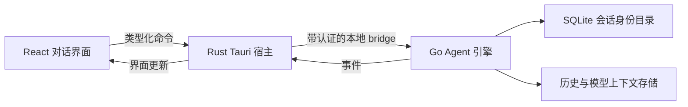

<p align="center">
  
</p>

# Reasonix Tauri

[English](./README.md) · [Tauri 宿主说明](./desktop/tauri/README.md) · [迁移清单](./docs/tauri/E_MIGRATION_CHECKLIST.md)

基于 Reasonix 独立维护的 Tauri 桌面改造分支。重点改造桌面交互、配置管理与 macOS、Windows、Linux 原生打包，沿用现有 Go Agent 引擎。

当前仓库：[woaidachengzi/DeepSeek-Reasonix](https://github.com/woaidachengzi/DeepSeek-Reasonix) · 当前分支：`experiment/tauri`

## 维护者与项目定位

本改造分支由 [woaidachengzi](https://github.com/woaidachengzi) 独立开发维护。Tauri 迁移和下述改进属于当前分支的工作；原有 Go 引擎及继承功能来自上游 Reasonix。

目前有两种明确区分的桌面运行方式：

| 方式 | 版本 / 应用标识 | 资料使用方式 |
| --- | --- | --- |
| **Reasonix Tauri Preview** | `0.1.0` / `io.reasonix.desktop.preview` | 使用独立托管资料目录，适合开发和隔离试用 |
| **Reasonix Tauri 原资料接管版** | `0.1.4` / `io.reasonix.desktop.takeover` | 完成备份核验与离线准备后，直接使用原 `~/.reasonix` |

此前 0.1.3 macOS Apple Silicon 接管候选包已通过当前历史及重启恢复验收，维护者已确认实际使用体验。0.1.4 新增多会话并行，其验收范围见下文。这表示已验证的资料接管路径可用，不代表所有历史格式、平台和正式发布门禁均已完成。

## 当前分支的改造内容

- **Tauri 桌面宿主**：Rust 外壳管理 Go sidecar、原生窗口、菜单与系统能力，前端通过类型化 bridge 通信。
- **桌面工作台**：项目与会话管理、模型选择、流式对话、Markdown、附件及会话生命周期管理。
- **历史与导航**：持久会话身份、目录分页与快照缓存、限制历史响应大小、查看会话与运行任务分离。项目可改名，空项目可从侧栏移除，保留磁盘文件。
- **多会话并行**：执行期间可切换和提交其他对话；输出、审批、停止、模型配置与草稿分别归属对应会话。最多驻留 16 个实例，活跃任务和保留资源受保护。见[架构与验收记录](./docs/tauri/PARALLEL_SESSIONS.md)。
- **消息级分叉对话**：从已完成的助手回答处分叉，在独立对话中继续，保留原对话。
- **固定上下文文件**：将工作区文件固定为持久对话上下文，分叉继承固定文件选择。
- **原资料接管**：完整备份核验、当前 Wails JSONL 原路径登记，以及选定旧 v5 记录的兼容投影；准备过程中保留原配置和源记录。
- **模型与配置页面**：服务商和模型设置、凭据保存/删除；模型偏好与模型服务页面在不同主题、布局下统一整体底色。
- **远程管理**：SSH 认证和主机指纹确认、SFTP 浏览/编辑/路径操作，以及 Serve 状态、日志、启停和系统浏览器 controller 入口。
- **机器人与管理页迁移**：账号管理、配对审批，以及权限、插件、MCP、hooks、memory、subagents、数据和诊断等配置面；迁移和真实服务验收仍逐项推进。
- **原生安装包**：Windows x64 NSIS、Linux ARM64 原生 deb/AppImage Preview，以及平台对应的托盘和窗口关闭行为。
- **档案隔离与验证**：托管 Preview 资料与稳定版分离；记录源码身份、回归结果、安装包摘要和验收证据。

上述是已接入的功能面，不代表与 Wails 完全对齐。Tauri 原生远程 tab、剩余机器人流程、管理页实际包验收等见 [E 迁移清单](./docs/tauri/E_MIGRATION_CHECKLIST.md)。自动更新不在本轮迁移范围内。

## Tauri 在这个项目中的好处

- **原生桌面宿主，沿用现有网页界面。** Tauri 使用系统 WebView：macOS 为 WKWebView，Windows 为 WebView2，Linux 为 WebKitGTK，无需随应用分发独立浏览器运行时。参见官方[进程模型](https://v2.tauri.app/concept/process-model/)。
- **桌面能力的职责更清楚。** Rust 负责窗口、菜单、原生弹窗、凭据存储和 sidecar 生命周期；React 界面通过类型化命令与事件调用这些能力。Tauri 的 [IPC 模型](https://v2.tauri.app/concept/inter-process-communication/)提供通信边界，本项目的 bridge 另行执行协议和输入校验。
- **复用 Go Agent 引擎。** 模型调用、工具、配置和会话恢复继续留在 Go 中；桌面宿主可独立改进，Rust 负责 sidecar 的启动、重启和退出清理，避免重写已有 Agent 行为。
- **打包与资料模式可分别验证。** 各平台的原生打包配置，以及独立的 Preview／接管应用身份，便于先用私有夹具验证桌面改动，再使用已有资料。

实际使用中的改善来自宿主、历史读取、渲染和生命周期等多方面修复。目前未发布同条件下 Wails 与 Tauri 的内存或延迟对比基准。

## 历史会话的架构改造



“最近对话列表”现在主要承担导航元数据职责，不再作为会话是否存在的唯一依据。打开、分页、改名和删除建立在持久身份目录及已核验的历史文件归属之上。

| 层次 | 改造内容 | 使用上的收益 |
| --- | --- | --- |
| 身份目录 | SQLite 保存会话 ID、资料目录内相对路径、工作区、标题及修订、顺序和生命周期状态 | 重启后身份可恢复；已删除、缺失或路径变化的会话不会被静默创建为空对话 |
| 原路径兼容 | 导入的 Wails 身份绑定原 JSONL 相对路径的哈希 | 当前项目历史沿用原位置，拒绝未知或路径不匹配的旧身份 |
| 目录与历史读取 | 目录游标带快照身份并缓存已审计快照；目录检查离开原生事件循环执行，历史响应最多包含最近 200 条可见消息 | 减少重复目录审计及传入、渲染到界面的内容，避免混用过期目录分页 |
| 显示历史与模型上下文 | 完整显示历史与已压缩的模型工作集分别保留，并检查覆盖范围和来源 | 接管后可读原历史，也保留原模型上下文，不从界面文字重新拼装上下文 |
| 分叉与固定文件 | 用已完成回答的前缀 token 确定分叉位置；子会话使用独立身份并继承固定文件选择 | 从指定回答继续探索，保留原对话 |
| 接管准备 | 停止写入、核验完整备份，在 profile gate 内准备身份与兼容投影，最后发布完成凭据 | 接管宿主拒绝未准备的资料；不支持同一 gate 的旧二进制仍须避免同时运行 |

最近 200 条是当前历史接口的显示上限，尚非完整的向前翻页浏览。引擎恢复时仍可能读取完整历史；端到端性能和更早消息浏览还需继续改进。

本次接管验收覆盖 **25 个当前对话**：**21 个**沿用原 JSONL 路径，**4 个**使用匹配的旧 v5 投影补齐。安装包内的真实宿主逐条打开并验证重启前后历史消息数一致；原生界面还验证了原历史重开、最近目录登记、启动重放和分叉入口。这是本次资料的验证范围，不代表所有用户的历史格式都已覆盖。详见[接管实现与验收记录](./docs/tauri/STABLE_TAKEOVER.md)。

## 平台状态

截至 2026-10-14；Windows／Linux 行保留 2026-10-07 的验收范围：

| 平台 | 安装包 | 当前验证情况 |
| --- | --- | --- |
| macOS Apple Silicon | `0.1.4` 接管 app / DMG，另保留隔离 Preview | 实际 Go 控制器、headless React 界面与私有夹具 Preview 原生宿主通过并行验收；新版接管包使用原数据的人工界面验收待完成；ad hoc 签名，未 Apple 公证 |
| Windows x64 | NSIS 安装器 `.exe` | 已完成构建和包结构检查；完整原生手动矩阵尚未逐项记录 |
| Ubuntu 26.04 ARM64 | `.deb` / `.AppImage` | 原生构建、包审计完成，Rust 224 项通过 / 1 项忽略；维护者已确认手动验收通过 |
| Linux x64 / 其他发行版 | 同架构构建适配及手动 x64 打包工作流 | 不能继承 Ubuntu ARM64 的通过结论 |

详见 [Windows 验收](./docs/tauri/WINDOWS_PREVIEW_ACCEPTANCE.md)、[Linux 验收](./docs/tauri/LINUX_PREVIEW_ACCEPTANCE.md) 和 [Ubuntu 包摘要](./docs/tauri/evidence/2026-10-07-linux-arm64/README.md)。

`0.1.4` 接管候选包为本地 macOS 交付，不代表已建立 Apple 公证或自动更新的稳定发布渠道。上游 npm 包、官网、下载页及签名声明不代表本分支的 Tauri 安装包。

## 安装与选择资料模式

使用与你的系统、架构对应的交付包，运行前核对随包 SHA256。安装并启动 **Reasonix Tauri Preview** 后，在应用内配置模型服务即可。

macOS Apple Silicon 接管包：打开 `Reasonix Tauri_0.1.4_aarch64.dmg`，将 **Reasonix Tauri** 拖入 Applications。原资料目录须事先完成完整备份核验，并具有匹配的 `tauri-takeover-v1.json` 完成凭据；单纯构建或安装不会代办接管准备。保留凭据引用的备份，使用接管版前完全退出 Wails。准备与回退见[接管记录](./docs/tauri/STABLE_TAKEOVER.md)。该本地候选包为 ad hoc 签名，尚未 Apple 公证。

Ubuntu ARM64 交付包可在安装包目录打开终端执行：

```bash
sha256sum -c SHA256SUMS
sudo apt install "./Reasonix Tauri Preview_0.1.0_arm64.deb"
```

也可选择 AppImage：

```bash
chmod +x "./Reasonix Tauri Preview_0.1.0_aarch64.AppImage"
"./Reasonix Tauri Preview_0.1.0_aarch64.AppImage"
# 没有 FUSE 支持时使用提取模式：
APPIMAGE_EXTRACT_AND_RUN=1 "./Reasonix Tauri Preview_0.1.0_aarch64.AppImage"
```

安装包不携带维护者的个人 API key 或配置。默认模型条目不等于已保存凭据，请配置自己的服务凭据。Linux 系统凭据保存需要可用的会话 D-Bus 和 Secret Service。

默认托管 Preview 档案与稳定版 `~/.reasonix` 分离，旧资料仅在明确操作后导入。Preview 中显式设置 `REASONIX_HOME` 可选择符合宿主保护规则的资料目录；接管安装版则选择原默认目录并检查完成凭据，不能用环境变量覆盖来代替已核验的接管准备。

## 从当前分支构建

需要 Node 24+、pnpm 10.34.5、与 `go.mod` 匹配的 Go（当前固定工具链 1.26.6）、Rust 1.89+，以及目标系统的原生构建和 WebView 依赖。Tauri 使用前端目录内的本地 CLI，不需要 Wails CLI。

```bash
git clone --branch experiment/tauri https://github.com/woaidachengzi/DeepSeek-Reasonix.git
cd DeepSeek-Reasonix
pnpm --dir desktop/frontend install --frozen-lockfile
pnpm --dir desktop/frontend tauri:dev
```

macOS 隔离 Preview 打包：

```bash
pnpm --dir desktop/frontend tauri:build
```

macOS 原资料接管版打包（启动前另行完成资料准备）：

```bash
pnpm --dir desktop/frontend tauri:build -- --config tauri.takeover.conf.json --bundles app,dmg
```

接管 App 和 DMG 产物位于 `desktop/tauri/target/release/bundle/`。本次接管验收仅覆盖 macOS Apple Silicon。

Windows 原生构建，准备 Visual Studio C++ Build Tools 后，在仓库根目录执行：

```powershell
powershell -ExecutionPolicy Bypass -File desktop/tauri/scripts/build-windows.ps1
```

Linux 在同架构 GNU Linux 上准备 GTK/WebKitGTK 等依赖后执行：

```bash
bash desktop/tauri/scripts/build-linux.sh
# 仅生成 Debian 包：
bash desktop/tauri/scripts/build-linux.sh deb
```

Linux 产物位于 `desktop/tauri/target/<本机 Rust triple>/release/bundle/`。此打包路径不支持 macOS→Linux 或 Linux 跨架构构建。详细说明及 Windows 交叉编译前提见 [Tauri 宿主文档](./desktop/tauri/README.md)。

继承的 CLI 仍可用 `make build` 构建；旧 Wails 构建方法保留在 [desktop/README.md](./desktop/README.md)。它们与 Tauri Preview 的构建方式不同。

## 文档入口

- [Tauri 宿主、开发和档案边界](./desktop/tauri/README.md)
- [0.1.3 MiMo 模型切换修复](./docs/tauri/MIMO_MODEL_SWITCH_RECOVERY.md)
- [0.1.2 历史模型恢复修复](./docs/tauri/HISTORY_MODEL_RECOVERY.md)
- [原资料接管、验收与回退](./docs/tauri/STABLE_TAKEOVER.md)
- [E 迁移范围与未完成项](./docs/tauri/E_MIGRATION_CHECKLIST.md)
- [API 功能审计与发布门禁](./docs/tauri/API_SURFACE_AUDIT.md)
- [Windows Preview 验收](./docs/tauri/WINDOWS_PREVIEW_ACCEPTANCE.md)
- [Linux Preview 验收](./docs/tauri/LINUX_PREVIEW_ACCEPTANCE.md)
- 继承的引擎文档：[指南](./docs/GUIDE.zh-CN.md) · [CLI](./docs/CLI.zh-CN.md) · [ACP](./docs/ACP.zh-CN.md) · [扩展开发](./docs/EXTENSIONS.zh-CN.md) · [配置路径](./docs/CONFIG_PATHS.zh-CN.md)

引擎和旧桌面端文档可能描述上游/Wails 行为，当前 Preview 的实际范围以 Tauri 迁移和验收记录为准。

## 项目来源与许可证

本项目基于 [esengine/DeepSeek-Reasonix](https://github.com/esengine/DeepSeek-Reasonix) 开发，感谢上游作者和贡献者提供原有引擎及项目基础。沿用的项目 logo 来自 [Bernardxu123](https://github.com/Bernardxu123)。

上游贡献者属于原项目的历史贡献者，不是本 Tauri 改造分支的开发人员名单。本首页不将上游贡献榜或收款入口展示为当前分支的信息。

原有版权声明和 MIT 许可文本保留在 [LICENSE](./LICENSE)。
