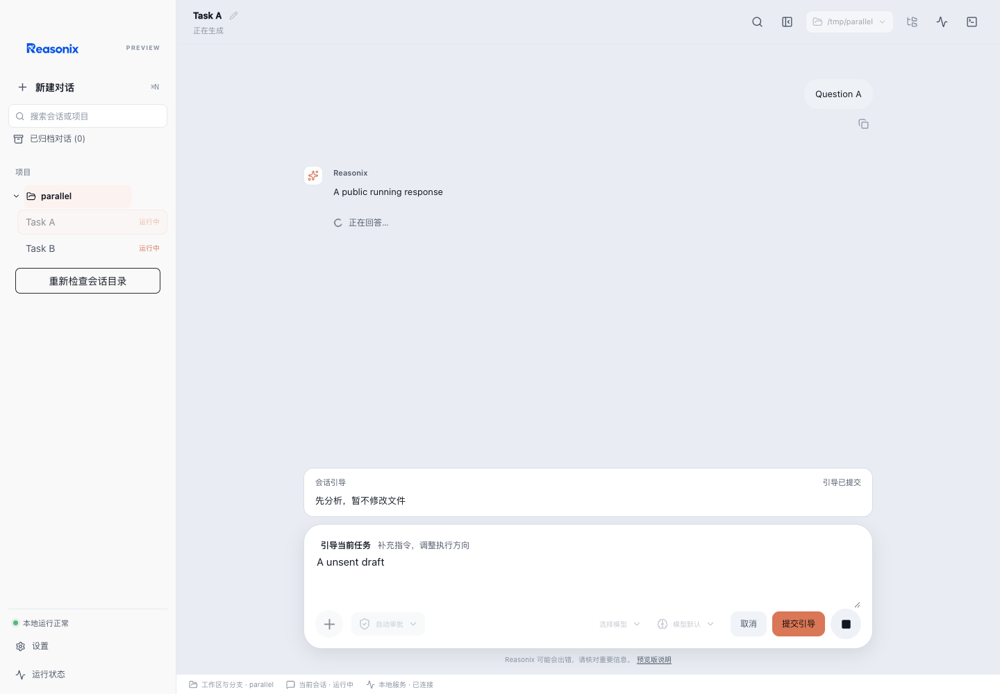
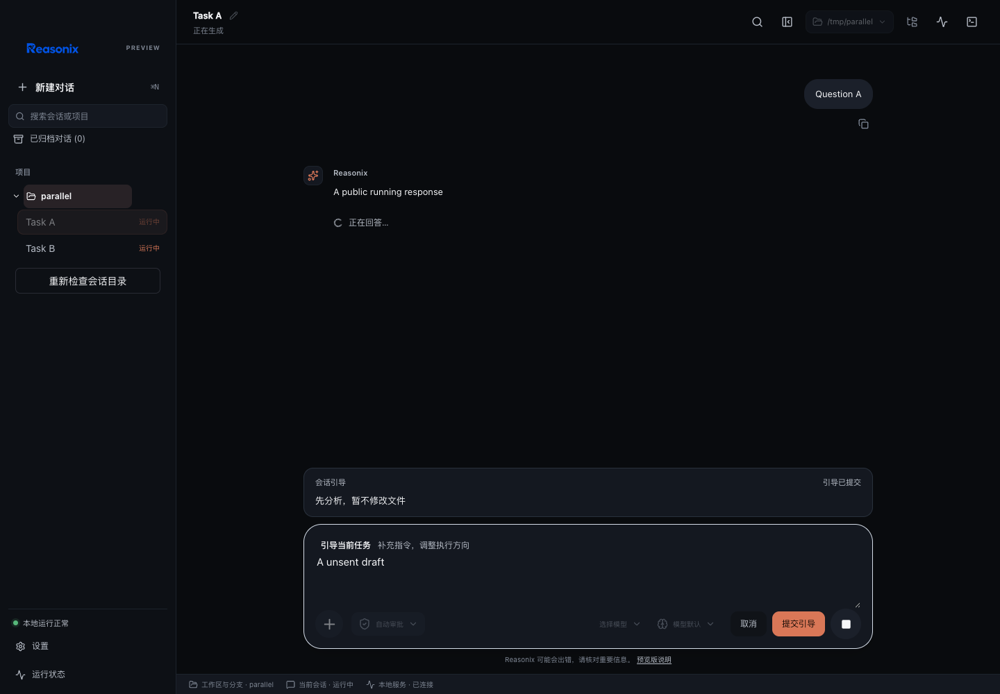

# 引导编辑与内容卡片 0.1.7

macOS ARM64 原资料接管候选 App／DMG，源码 `20d06bb13`。类型检查、hooks lint、CSS／主题令牌、单滚动写入和 bundle 大小门禁通过。App 及只读挂载 DMG 内的 App 严格签名校验通过，宿主／sidecar 字节一致；SHA256 见 `package.json`。

组件回归验证明确提交／取消、取消无请求、失败保留输入、成功显示原文、后台应用只更新对应会话，以及未应用状态保留原文。现有 Playwright／Chrome 验证真实组件深浅主题，独立停止、会话切换及布局通过，console／框架错误为 0。截图中的 native bridge 为隔离模拟，不是真实用户资料；本轮没有新增原生 App 人工点击验收记录。

当前包未替换 Applications 中的副本。行为见[引导会话](../../SESSION_STEERING.md)。
